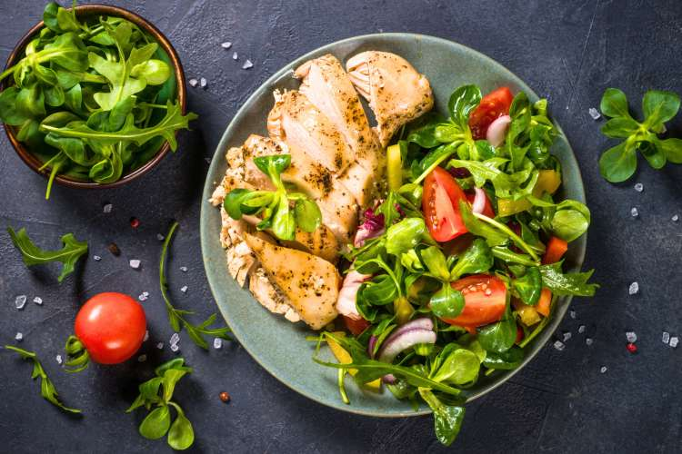

# Hidup Sehat
Website Edukasi Kesehatan Masyarakat
SDG 3

## Anggota Kelompok
1. Ni Kadek Mia Ulandari - 2515091014 - Halaman Beranda dan Halaman Edukasi
2. Ni Made Liana Pradnyadiani - 2515091029 - Halaman Informasi
3. Ana Selvia Julianti - 2515091051 - Halaman Panduan
4. Putu Ayu Dian Melani - 2515091060 - Halaman Tentang

## Deskripsi Website
Sehat Bersama adalah website edukasi kesehatan yang mendukung **SDG 3: Kehidupan Sehat dan Sejahtera**. Lewat website ini, kami ingin mengajak masyarakat mengenal kebiasaan hidup sehat, mulai dari makan bergizi seimbang, rutin bergerak, sampai istirahat yang cukup. Tips yang kami bagikan sederhana dan bisa langsung dicoba di rumah tanpa alat atau biaya khusus. Kami juga ingin orang lebih sadar bahwa menjaga kesehatan itu lebih baik dilakukan sejak awal, bukan setelah sakit, dengan merujuk ke sumber tepercaya seperti Kementerian Kesehatan RI dan WHO.

Dengan membuka website ini, pengunjung bisa menambah wawasan tentang apa yang dibutuhkan tubuh lewat materi yang singkat dan mudah dipahami. Panduannya disusun bertahap, jadi siapa pun bisa mulai dari perubahan kecil dan menjaganya tetap konsisten. Tampilannya juga responsif, jadi tetap nyaman dibuka di desktop, tablet, maupun smartphone.

Website ini ditujukan untuk masyarakat umum yang ingin mulai hidup lebih sehat tapi belum tahu mulai dari mana, terutama pelajar, mahasiswa, dan keluarga muda. Bahasanya dibuat santai dan mudah dipahami, jadi bisa dibaca siapa saja tanpa perlu punya latar belakang kesehatan.

## Halaman Website
Website Sehat Bersama terdiri dari lima halaman yang saling terhubung lewat menu navigasi di bagian atas:
1. Beranda (`index.html`): halaman pembuka yang memperkenalkan Sehat Bersama dan pentingnya hidup sehat. Isinya ada pengantar singkat, cuplikan topik edukasi (gizi seimbang, aktivitas fisik, dan istirahat), serta ajakan untuk mulai membangun kebiasaan sehat dari hal kecil. Dari sini pengunjung bisa langsung menuju halaman lain.
2. Edukasi (`edukasi.html`): tempat pengunjung mengenal dasar-dasar hidup sehat, seperti memilih makanan bergizi, pentingnya tetap aktif bergerak, dan kebutuhan istirahat yang cukup, dengan penjelasan yang singkat dan mudah dipahami.
3. Panduan (`panduan.html`): berisi tips praktis yang bisa langsung dicoba sehari-hari, misalnya aktivitas fisik ringan, mengelola stres, dan menjaga pola tidur yang sehat.
4. Informasi (`informasi.html`): kumpulan materi pendukung seperti artikel kesehatan, mitos dan fakta, atau infografis untuk menambah wawasan pengunjung.
5. Tentang (`tentang.html`): menjelaskan tujuan website, empat pilar hidup sehat yang dibahas (gizi seimbang, aktivitas fisik, kesehatan mental, dan pencegahan penyakit), profil tim pengembang, serta daftar referensi tepercaya seperti Kementerian Kesehatan RI dan WHO.

## Teknologi
1. HTML5 – Digunakan untuk menyusun struktur halaman website edukasi kesehatan.
2. CSS3 – Digunakan untuk mengatur warna, tipografi, kartu informasi, dan tampilan website.
3. CSS Flexbox – Digunakan untuk mengatur posisi elemen header dan navigasi.
4. CSS Grid – Digunakan untuk menyusun kartu informasi dan konten edukasi.
5. CSS Media Queries – Digunakan untuk menyesuaikan tampilan website pada berbagai ukuran layar, seperti desktop, tablet, dan smartphone.
6. Google Fonts – Digunakan untuk mengatur jenis huruf agar teks mudah dibaca.
7. GitHub Pages – Digunakan untuk memublikasikan website agar dapat diakses secara online.
Website dikembangkan menggunakan HTML5 dan CSS3 untuk menyajikan informasi edukasi kesehatan masyarakat secara menarik dan responsif.

## Penjelasan Implementasi

1. Struktur HTML5
HTML5 digunakan untuk menyusun halaman website dengan elemen semantik seperti `<header>`, `<nav>`, `<main>`, `<section>`, `<article>`, dan `<footer>`. Elemen tersebut digunakan untuk memisahkan bagian navigasi, konten edukasi kesehatan, kartu informasi, dan bagian penutup website.

Contoh kode:

```html
<main>
    <section class="hero">
        <div class="hero-text">
            <h1>Hidup Sehat,
                <span>Ayo Mulai dari Sekarang</span>
            </h1>
            <p>Mulai bangun kebiasaan sehat
               dari langkah kecil setiap hari.</p>
            <a href="edukasi.html" class="btn">
                Mulai Jelajahi
            </a>
        </div>
    </section>
</main>
```

Kode tersebut digunakan untuk menampilkan bagian utama website yang berisi judul, deskripsi, dan tombol menuju halaman edukasi.

### 2. Navigasi Website
Navigasi digunakan untuk memudahkan pengguna berpindah ant halaman, yaitu Beranda, Edukasi, Panduan, Informasi, dan Tentang. Setiap menu menggunakan elemen `<a>` dengan atribut `href` yang mengarah ke file HTML tujuan.

Contoh kode:

```html
<nav class="navbar">
    <a href="index.html" class="active">Beranda</a>
    <a href="edukasi.html">Edukasi</a>
    <a href="panduan.html">Panduan</a>
    <a href="informasi.html">Informasi</a>
    <a href="tentang.html">Tentang</a>
</nav>
```

Class `active` digunakan untuk menandai halaman yang sedang dibuka, sedangkan atribut `href` berfungsi menghubungkan setiap menu dengan halaman yang sesuai.

### 3. Layout dengan Flexbox dan CSS Grid
Flexbox digunakan untuk mengatur posisi elemen, seperti bagian header, navigasi, dan konten yang membutuhkan penyusunan sejajar. Sementara itu, CSS Grid digunakan untuk menyusun kartu edukasi kesehatan, seperti informasi mengenai gizi seimbang, aktivitas fisik, dan istirahat.

Contoh kode CSS:

```css
.artikel-grid {
    display: grid;
    grid-template-columns: repeat(3, 1fr);
    gap: 24px;
}
```

Properti `display: grid` mengaktifkan tata letak Grid, `grid-template-columns` membagi konten menjadi tiga kolom dengan ukuran yang sama, sedangkan `gap` mengatur jarak antar-kartu agar tampilan lebih rapi.

### 4. Responsive Design
Responsive design diterapkan menggunakan CSS Media Queries agar tampilan website dapat menyesuaikan ukuran layar perangkat desktop, tablet, dan smartphone. Penyesuaian ini membantu menjaga keterbacaan teks, ukuran gambar, dan susunan konten pada layar yang lebih kecil.

Contoh kode:

```css
@media (max-width: 768px) {
    .artikel-grid {
        grid-template-columns: 1fr;
    }
}
```

Kode tersebut mengubah susunan kartu menjadi satu kolom ketika lebar layar maksimal 768 piksel. Dengan demikian, kartu edukasi lebih mudah dibaca pada perangkat berlayar kecil.

### 5. Penggunaan Gambar dan CSS Eksternal
Gambar digunakan untuk mendukung penyampaian informasi kesehatan agar website lebih menarik dan mudah dipahami. Setiap gambar informatif dilengkapi atribut `alt` sebagai deskripsi gambar. Pengaturan tampilan dilakukan melalui file CSS eksternal yang dihubungkan menggunakan elemen `<link>`.

Contoh kode HTML:

```html

```

Kode tersebut menampilkan gambar makanan sehat dengan deskripsi alternatif untuk membantu aksesibilitas. Sementara itu, CSS eksternal digunakan untuk mengatur warna, tipografi, jarak, ukuran gambar, dan tampilan kartu agar konsisten di setiap halaman.

## Struktur Folder dan File

```text
Hidup-Sehat/
├── index.html              # Halaman utama (Beranda)
├── edukasi.html            # Halaman edukasi kesehatan
├── panduan.html            # Halaman panduan hidup sehat
├── informasi.html          # Halaman informasi kesehatan
├── tentang.html            # Halaman tentang website
├── style-beranda.css       # Styling halaman beranda
├── style-edukasi.css       # Styling halaman edukasi
├── style-panduan.css       # Styling halaman panduan
├── style-informasi.css     # Styling halaman informasi
├── style-tentang.css       # Styling halaman tentang
├── beranda.jpg             # Gambar pendukung beranda
├── food.jpg                # Gambar makanan sehat
├── olahraga.jpg            # Gambar aktivitas olahraga
├── istirahat.jpg           # Gambar istirahat
├── Aktivitas fisik.jpg     # Ilustrasi aktivitas fisik
├── Kesehatan mental.jpg    # Ilustrasi kesehatan mental
├── Makanan sehat.jpg       # Ilustrasi makanan sehat
├── Pola tidur.jpg          # Ilustrasi pola tidur
├── hero-sehat.svg          # Ilustrasi utama website
├── pilar-aktivitas.svg     # Ilustrasi pilar aktivitas fisik
├── pilar-gizi.svg          # Ilustrasi pilar gizi
├── pilar-mental.svg        # Ilustrasi pilar kesehatan mental
├── pilar-pencegahan.svg    # Ilustrasi pilar pencegahan penyakit
├── ana.jpeg                # Foto anggota/pengembang
├── dian.jpeg               # Foto anggota/pengembang
├── liana.jpeg              # Foto anggota/pengembang
├── miaa.jpeg               # Foto anggota/pengembang
└── README.md               # Dokumentasi proyek
```

#Website dan Repository
1. URL Github Pages:  https://miaulandari.github.io/Hidup-Sehat/
2. URL Repository: https://github.com/miaulandari/Hidup-Sehat

## Referensi
1. Kementerian Kesehatan Republik Indonesia. Informasi kesehatan masyarakat. https://www.kemkes.go.id/
2. World Health Organization (WHO). Informasi kesehatan dan pola hidup sehat. https://www.who.int/health-topics
3. United Nations. Sustainable Development Goal 3: Good Health and Well-Being. https://sdgs.un.org/goals/goal3
4. GitHub. Repository website Hidup Sehat. https://github.com/miaulandari/Hidup-Sehat
